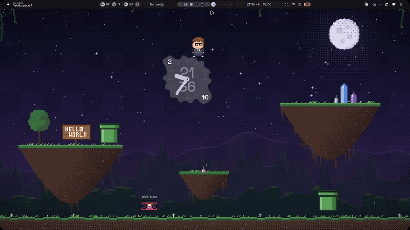

# hypr-pixel-buddy

A pixel-art desktop for **Hyprland + [illogical-impulse](https://github.com/end-4/dots-hyprland)** (Quickshell), with a little dev who lives in the wallpaper.

> **Heads up: this is my personal config.** It's tuned for my setup and my habits. I use an **AZERTY** keyboard, so the keybinds (workspaces especially) assume an AZERTY layout. On QWERTY you'll want to edit `hypr/custom/keybinds.lua` before installing. Some of the buddy's phrases are in French, too. Feel free to take what you like and adapt the rest.



## What's inside

**The world.** A night-time pixel-art wallpaper (moon, floating islands, crystals, a `HELLO WORLD` sign, warp pipes). It is generated by a script, so you can tweak it and regenerate it. Ambient animations stay discreet: fireflies, crystal glints, the occasional shooting star.

**The buddy.** A Quickshell layer that sits between the wallpaper and your windows. He has a mind of his own:

- he walks around and jumps from island to island (with real gravity);
- he sits down to code on his laptop (`{ }`, `git`, `</>` float up), then either celebrates or facepalms over a bug;
- he drinks coffee and naps (`Zzz`);
- he takes the warp pipe and pops out on another island;
- he hunts the bugs that show up from time to time ("Bug fixé ✔");
- he climbs on the clock widget, rides it, jumps on it to push it around or headbutts it from below;
- he says a random funny phrase once a day (`phrases.txt`).

**You can mess with him:**

| Action | Reaction |
| --- | --- |
| Click | He gets annoyed. Keep going and he pulls out a (flag) gun: *"Pose cette souris. LENTEMENT."* |
| Drag | You carry him around. He struggles and complains the whole time. |
| Throw / drop him from high | He falls, bounces, gets flattened and sees stars. |
| Drag the clock into him | He gets knocked away spinning, or squashed if it comes from above. |
| Right click | Phrase of the day. |
| Click the boombox | **Aura battle.** He dances: Aura Farming ⛵, Danse Vampira 🦇, Floss, Dab, Gangnam Style, Macarena, Griddy, Moonwalk 🌙 (+1000 aura). Right click stops the dance. |

Everything pauses when windows cover the desktop, so it uses 0% CPU while you work.

**Extras (Hyprland keybinds):**

- AZERTY workspace binds (this is my layout; QWERTY users should change these): `Super+Alt+& é " …` sends a window to a workspace, `Super+Shift+& é " …` moves it there and follows it.
- Screenshots saved to `~/Pictures/Screenshots` and copied to the clipboard: `Super+Ctrl+Shift+S` / `Shift+Print` (region), `Super+Print` (full screen), `Super+Shift+E` (region + annotate with swappy).

## Install

Requirements: Hyprland with the illogical-impulse dots (Quickshell `qs`), plus `jq`, `grim`, `slurp`, `swappy`, `wl-clipboard` and `python3-pillow` (only needed to regenerate the art).

```sh
git clone <this repo> && cd hypr-pixel-buddy
./install.sh
```

`install.sh` does the following:

- copies `quickshell/buddy` to `~/.config/quickshell/buddy`;
- copies the Hyprland files to `~/.config/hypr/custom`, backing up any existing ones as `*.bak`;
- applies a small patch to illogical-impulse (see below);
- sets the wallpaper and makes the clock draggable;
- starts the buddy;
- installs a small watchdog that relaunches `ii` or the buddy on its own if either one crashes, so you don't have to reload Hyprland by hand.

### The ii patch

`patches/ii-clock-buddy.patch` adds about 20 lines to `AbstractBackgroundWidget.qml`:

- the clock follows positions written to `config.json`, so the buddy can push it;
- while you drag the clock, it streams its position to the buddy over a local socket (`$XDG_RUNTIME_DIR/qs-buddy.sock`), so it can hit him.

An ii update may overwrite the patch. Run `./install.sh` again to re-apply it.

## Control it from the terminal

```sh
qs -c buddy ipc call buddy act code     # code | coffee | sleep | wave | hop | pipe | clock | stomp | bump | bug | poke | gun | drop | dance
qs -c buddy ipc call buddy dance vampira
qs -c buddy ipc call buddy say "Hello, World!"
qs -c buddy ipc call buddy state
```

## Customize

- `quickshell/buddy/phrases.txt`: phrases of the day, one per line. The file reloads live.
- `quickshell/buddy/tools/make_world.py`: regenerates the wallpaper and `scene.json` (platform positions).
- `quickshell/buddy/tools/make_sprite.py`: regenerates the sprite sheet (the character is built from parts, and adding a pose takes one line).

---

Made with [Claude Code](https://claude.com/claude-code).
